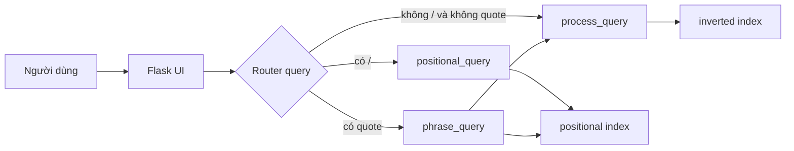

# ĐẶC TẢ NGỮ CẢNH CHO AI VIẾT BÁO CÁO
## Dự án: Boolean Retrieval Model
## File này KHÔNG phải báo cáo nộp thầy. Đây là source of truth + brief + gói ngữ cảnh.

**Cách dùng cho người nộp:** Đừng chỉ dán file này. Gói tối thiểu gửi AI viết báo cáo:

1. File này (`DAC_TA_CHI_TIET_BAO_CAO.md`)
2. Toàn bộ mã: `main.py`, `boolean_models.py`, `query_processing.py` (đã copy ở mục **F** bên dưới nếu quên đính kèm)
3. `Stopword-List.txt`, `Querry List.txt`, `README.txt`
4. `templates/home.html`, `templates/dictionary.html`
5. Ảnh đề bài thầy (mục 5) nếu còn phần bị che — phần nhìn thấy đã ghi ở **A0**
6. (Khi có) screenshot demo để AI viết caption cho đúng; nếu chưa có, AI phải giữ placeholder `[chèn …]`

AI viết tiểu luận **không được** đổi mục lục 6 chương, **không được** bịa tính năng, **không được** “làm đẹp” bug thành feature, **không được** copy nguyên văn diễn văn trong corpus.

---

# A0. ĐỀ BÀI THẦY (phần nhìn thấy trên đề) — BẮT BÁO CÁO BÁM ĐÚNG

Nội dung đề đã chụp được (mục 5). Giữa ảnh có thanh đen che một đoạn; **không bịa** các gạch đầu dòng bị che. Chỉ viết những gì nhìn thấy + những gì **code thật sự có**.

> **5. Xây dựng hệ thống truy xuất văn bản sử dụng mô hình Boolean**
> - Xây dựng Inverted Index.
> - Hỗ trợ AND, OR, NOT.
> - (đoạn giữa ảnh bị che — không suy diễn thành yêu cầu chưa đọc được)
> - Thực hiện và đánh giá một tập truy vấn.

**Map đề → sản phẩm thật (viết vào Chương 1 và Chương 5):**

| Yêu cầu đề (thấy được) | Sản phẩm đáp ứng thế nào | Viết ở chương |
|---|---|---|
| Hệ thống Boolean | Unranked Boolean retrieval trên 56 speech, web Flask | 1, 3, 4 |
| Inverted Index | `boolean_models.inverted_index` → `term → [docID]` | 2, 3, 4 |
| AND, OR, NOT | `AND_op`, `OR_op`, `NOT_op` + `process_query` + ngoặc | 2, 4, 5 |
| Thực hiện tập truy vấn | Chạy các query trong `Querry List.txt` + README trên UI | 5 |
| Đánh giá tập truy vấn | **Đánh giá chức năng / định tính** trên tập query có sẵn: loại query, số doc, so AND vs OR vs NOT vs proximity, nhận xét hợp lý. **Không có qrels** nên **không** bịa Precision/Recall/F1/MAP. Nếu thầy bắt buộc có độ đo: nêu công thức lý thuyết + nói rõ đồ án **chưa gắn nhãn relevant**, chỉ đánh giá bằng nhật ký kết quả và demo. | 2.6, 5.4, 5.5 |

**Phần code CÓ nhưng đề bị che / không đọc được:** positional index, phrase `"..."`, proximity `t1 t2 /k`, giao diện web. Viết trong báo cáo như **phần mở rộng đã cài**, không khẳng định “đề bắt buộc đúng câu chữ này” trừ khi người nộp gửi thêm ảnh đề đầy đủ.

---

# A1. AI KHÁC CẦN HIỂU HỆ THỐNG TRONG 60 GIÂY

Hệ thống là **máy tìm kiếm Boolean không xếp hạng** trên **56 file diễn văn** (`speech_0` … `speech_55`).

Khi mở app:

1. Đọc stopword.
2. Build **inverted index** (Boolean) và **positional index** (phrase/proximity) **hết vào RAM**, mỗi lần chạy lại build.
3. User gõ 1 câu vào ô search.
4. `main.py` **đoán loại query rất thô**:
   - có ký tự `/` → proximity (`positional_query`)
   - không `/` và không `"` → Boolean (`process_query` + inverted)
   - có `"` → phrase (`phrase_query` + positional)
5. Trả về tập `speech_N` + thời gian xử lý query (không gồm lúc build index).
6. Bấm “Click to read!” xem text.

Ba câu người dùng thật:

- Boolean: `actions AND wanted` ; `biggest AND ( near OR box )` ; `not hammer`
- Phrase: `"Hillary Clinton"`
- Proximity: `after years /1`  (trong **code**, `/1` nghĩa là hai từ cách **đúng 2 vị trí**, tức một token ở giữa, vì `skip = k+1` và so `==` không phải `<=`)

Nếu chỉ nhớ 3 ý này + bảng lệch inverted vs positional (Chương 3) thì AI đã nắm “linh hồn” đồ án. Phần còn lại là chi tiết để viết cho dày và đúng.

**Từ điển thuật ngữ (dùng thống nhất trong báo cáo):**

| Thuật ngữ | Nghĩa trong đồ án |
|---|---|
| Term / stem | Token sau lower + (với inverted) bỏ stopword + Porter |
| Posting list | Danh sách docID chứa term; inverted còn unique bằng `set` |
| Vũ trụ U | `{0,1,…,55}` biến `doc_ids` |
| Unranked | Không có điểm; chỉ thuộc / không thuộc kết quả |
| Infix | Query người dùng có ngoặc, AND/OR/NOT ở giữa |
| Postfix / RPN | Dãy token máy tính lần lượt bằng stack |
| `/k` | Proximity; **code:** `|pos1-pos2| == k+1` |
| Phrase | Query có dấu `"` ; kiểm tra khoảng cách so với từ **đầu** |
| qrels | File “doc nào relevant với query nào” — **repo không có** |

---

# A. PROMPT BẮT BUỘC CHO AI VIẾT BÁO CÁO

Bạn viết **tiểu luận / báo cáo đồ án** môn Information Retrieval bằng **tiếng Việt** (giữ nguyên tên hàm, file, toán tử, query mẫu).

Bạn **chỉ** viết theo đúng mục lục 6 chương dưới đây. Không thêm chương 7, không gộp chương, không đổi tên chương. Có thể có mục con `x.y`, `x.y.z` bên trong mỗi chương.

## Mục lục bắt buộc

```
Trang bìa, lời cam đoan (nếu cần), mục lục
Chương 1. Giới thiệu đề tài
Chương 2. Cơ sở lý thuyết
Chương 3. Phân tích – thiết kế hệ thống
Chương 4. Hiện thực hệ thống
Chương 5. Vận hành hệ thống (demo)
Chương 6. Kết luận
Tài liệu tham khảo
Phụ lục (cú pháp query, stopword, hướng dẫn chạy)
```

## Hình / bảng / sơ đồ — bắt buộc

- Mỗi chương từ 1–5 phải có **ít nhất một bảng hoặc một sơ đồ**.
- Chương 3, 4, 5 phải có **sơ đồ** (Mermaid trong Markdown) **và** chỗ chèn ảnh.
- Chương 5 là chương demo: kịch bản chạy tay + chỗ dán screenshot.
- Đánh số: Hình 1.1, Bảng 1.1, Hình 2.1… theo chương.
- Dưới mỗi hình/bảng: câu **mô tả** (caption) bằng tiếng Việt.

## Format chỗ chèn ảnh (bắt buộc dùng đúng cú pháp ngoặc vuông)

Khi cần screenshot/ảnh thật mà bạn không có file ảnh, **đừng vẽ ASCII giả screenshot**. Chèn đúng một trong các khối sau, rồi viết 2–4 câu mô tả ngay bên dưới: ảnh đó phải chụp gì, người đọc sẽ thấy gì, chứng minh được bước nào.

Ví dụ bắt buộc dùng:

```
[chèn ảnh demo ở đây, kèm mô tả demo]
Mô tả: Trang chủ localhost:5000, ô Search here, tiêu đề Boolean Retrieval Model.

[chèn pipeline ở đây kèm demo]
Mô tả: Ảnh/sơ đồ pipeline tiền xử lý inverted_index: đọc file → clean → stopword → stem → posting.

[chèn ảnh kiến trúc hệ thống ở đây]
[chèn ảnh inverted index minh họa ở đây]
[chèn ảnh positional index minh họa ở đây]
[chèn ảnh giao diện kết quả tìm kiếm ở đây]
[chèn ảnh modal đọc tài liệu speech_N ở đây]
[chèn ảnh console/terminal chạy python main.py ở đây]
[chèn ảnh demo query Boolean: actions AND wanted]
[chèn ảnh demo query ngoặc: biggest AND ( near OR box )]
[chèn ảnh demo query phrase: "Hillary Clinton"]
[chèn ảnh demo query proximity: after years /1]
```

Có thể thêm placeholder cùng format `[chèn … ở đây]` nếu cần, nhưng **Chương 5 phải có đủ** các demo query trên + trang chủ + trang kết quả + modal.

## Giọng văn và độ dài

- Học thuật, rõ ràng, tiểu luận sinh viên.
- Gợi ý 4000–8000 chữ (15–25 trang khi đưa sang Word).
- Phân biệt **lý thuyết giáo trình** và **cách đồ án thực sự cài**.
- Trích code ngắn (vài dòng), không dán cả file.
- Không bịa Precision/Recall/F1/MAP. **Đánh giá tập truy vấn** = chạy + nhận xét tập `Querry List.txt` (mục A0, 5.4, 5.5, G). Không gọi đó là đánh giá Cranfield.
- Không nói hệ thống có ranking, ML, hay lemmatization (WordNet chỉ được import, không dùng).
- Chương 1 phải nêu đề mục 5 của thầy (Inverted Index, AND/OR/NOT, đánh giá tập truy vấn) rồi mới nói phần mở rộng phrase/proximity/web.

**Nguồn sự thật:** toàn bộ mục B trở đi. Map nội dung vào đúng chương như mục B chỉ định.

---

# B. DÀN Ý CHI TIẾT THEO TỪNG CHƯƠNG
## (AI viết báo cáo lấy ý từ đây, diễn đạt lại thành văn, không copy nguyên file đặc tả)

---

## Chương 1. Giới thiệu đề tài

**Việc phải viết**
1. Bối cảnh: tìm kiếm thông tin, nhu cầu truy hồi đúng/sai theo điều kiện logic (không xếp hạng).
2. Đặt vấn đề: corpus văn bản cố định, người dùng cần AND/OR/NOT, cụm từ, khoảng cách từ.
3. Mục tiêu đồ án.
4. Phạm vi / ngoài phạm vi.
5. Đóng góp (cài inverted + positional, web Flask, 3 loại query).
6. Tóm tắt cấu trúc 6 chương còn lại (1–2 câu/chương).

**Thông tin dự án (sự thật)**

| Hạng mục | Nội dung |
|---|---|
| Tên | Boolean Retrieval Model |
| Bài toán | Unranked Boolean retrieval: vào query, ra tập docID thỏa điều kiện |
| Ngôn ngữ | Python 3 |
| UI | Flask + HTML/CSS/jQuery |
| Corpus | 56 file `speech_0.txt` … `speech_55.txt` |
| Tác giả gốc README | Muhammad Taha Khan (GitHub `mtk12`) |
| Tính chất | Đồ án giáo dục |

**Trong phạm vi:** preprocess, inverted index, positional index, Boolean có ngoặc, phrase (`"`), proximity (`/k`), web local, đo thời gian **xử lý query** (không gồm build index).

**Ngoài phạm vi:** TF-IDF, VSM, BM25, ranking, PageRank, spelling, relevance feedback, nén index, distributed IR.

**Câu hỏi định hướng (có thể viết thành mục tiêu cụ thể):**
1. Biểu diễn corpus bằng inverted index để AND/OR/NOT?
2. Positional index cho phrase và proximity?
3. Preprocess (lower, contraction, punct, stopword, stem) ảnh hưởng khớp query thế nào?
4. Infix → postfix → stack trên posting?
5. Web tối thiểu để nhập query và đọc tài liệu?

**Hình/bảng Chương 1**
- Bảng 1.1: thông tin dự án (bảng trên).
- Có thể 1 sơ đồ ngữ cảnh: Người dùng → Web → Hệ thống IR → Corpus 56 docs.

```
[chèn ảnh ngữ cảnh hệ thống ở đây]
```

---

## Chương 2. Cơ sở lý thuyết

**Việc phải viết:** lý thuyết **chuẩn giáo trình** (Manning, Raghavan, Schütze, *Introduction to Information Retrieval*). Cuối mỗi mục, 1 đoạn “Đồ án áp dụng như sau…” — chi tiết cài đặt để Chương 4.

### 2.1. Mô hình Boolean
- Tài liệu = tập term sau chuẩn hóa.
- Query = biểu thức AND, OR, NOT, ngoặc.
- Kết quả = tập doc, **không điểm relevance**.
- Ưu: giải thích được, đúng/sai rõ.
- Nhược: cứng, user phải biết cú pháp, không xếp hạng.

### 2.2. Inverted index
- `term → posting list (docID)`.
- AND = giao, OR = hợp, NOT = `U \ P`.
- Giáo trình: merge posting đã sort.
- **Code đồ án:** `set.intersection` / `union`; unique bằng `set()` nên **mất thứ tự** posting (không ảnh hưởng set-ops).

### 2.3. Positional index
- `term → { docID → [vị trí] }`.
- Phrase: khoảng cách vị trí 1, 2, …
- Proximity `A B /k`.
- **Code:** `/k` nghĩa là `|p1-p2| == k+1` (đúng bằng, không phải “tối đa k”); dùng `abs` nên không bắt buộc thứ tự trái-phải.

### 2.4. Stemming và stopword
- Porter Stemmer (NLTK): `wanted→want`, `actions→action`; Hillary → `hillari`.
- Query và document phải cùng stemmer.
- Stopword đồ án: **26 từ**, không phải list NLTK đầy đủ.
- File `Stopword-List.txt`: `a, is, the, of, all, and, to, can, be, as, once, for, at, am, are, has, have, had, up, his, her, in, on, no, we, do`.
- `and` là stopword trong tài liệu nhưng là **toán tử** trên query.

### 2.5. Shunting-yard (infix → postfix)
- Độ ưu tiên code: NOT=3, AND=2, OR=1, ngoặc=0.
- So sánh `>` không `>=` → cùng bậc thì **kết hợp phải** (right-associative), khác left-associative chuẩn. Phải nêu trong lý thuyết vs cài đặt.

### 2.6. Độ đo IR (chỉ lý thuyết)
- Precision, Recall, F1, MAP: giải thích ngắn.
- **Đồ án không có qrels** → Chương 5 không tính các số này.

**Ví dụ sư phạm (Bảng 2.x + hình index)** — giả định 3 doc đã stem:

- D0: `want action`
- D1: `want plane`
- D2: `action`

Inverted: `want→[0,1]`, `action→[0,2]`, `plane→[1]`.  
`want AND action` = {0}; `want OR plane` = {0,1}; `NOT plane` = {0,2} nếu U={0,1,2}.

Positional: `want → {0:[0], 1:[0]}`, `action → {0:[1], 2:[0]}`.  
Phrase `"want action"` khớp D0 vì khoảng cách 1.

**Hình/bảng Chương 2**
- Bảng so sánh Boolean vs ranked retrieval.
- Hình inverted index; hình positional index.
- Sơ đồ shunting-yard.

```
[chèn ảnh inverted index minh họa ở đây]
[chèn ảnh positional index minh họa ở đây]
[chèn pipeline ở đây kèm demo]
```
Pipeline ở Chương 2 có thể là pipeline **lý thuyết** IR (tokenize → normalize → index). Pipeline **đúng code** vẽ ở Chương 3–4.

---

## Chương 3. Phân tích – thiết kế hệ thống

**Việc phải viết:** yêu cầu chức năng/phi chức năng, tác nhân, use case, kiến trúc, cấu trúc dữ liệu, thiết kế UI, quyết định router, **chưa** đi sâu từng dòng thuật toán (để Chương 4).

### 3.1. Phân tích yêu cầu

**Tác nhân:** người dùng local (trình duyệt).

**Chức năng:**
- UC1: mở trang chủ, nhập query.
- UC2: tìm Boolean / phrase / proximity (hệ thống tự phân nhánh).
- UC3: xem số tài liệu + thời gian.
- UC4: bấm “Click to read!” xem full text.

**Phi chức năng:** chạy localhost; index RAM lúc start; không lưu index đĩa; không đăng nhập.

### 3.2. Corpus và dữ liệu

Đường dẫn: `Trump Speechs/Trump Speechs/speech_{0..55}.txt`  
Code Windows: `"Trump Speechs\Trump Speechs\speech_" + str(doc_no) + ".txt"`.

- 56 tài liệu, `doc_id ∈ {0..55}`.
- Dòng 1 thường là tiêu đề diễn văn; phần còn lại transcript, có `[applause]`, `[laughter]`, nhãn speaker.
- `Querry List.txt`: nhật ký query + set docID (typo Querry), **không** phải test runner.
- Index **không pickle**; mỗi lần `python main.py` build lại.
- Biến `docu` sau cùng = documents của **positional_index** (gán đè inverted).

**Khác biệt đọc file hai index (Bảng bắt buộc — hạn chế thiết kế, không phải cải tiến):**

| Bước | `inverted_index` | `positional_index` |
|---|---|---|
| Tiêu đề | `next(file)` bỏ **cả dòng 1** | `[1:]` bỏ **1 ký tự đầu** |
| Số `[0-9]+` | xóa | không xóa |
| Stopword | loại | **không** loại (tham số `stop_words` **không dùng để lọc**) |
| Porter / lower / contraction / punct | có | có (punct/contraction gần giống) |

Hệ quả: Boolean và phrase/proximity **không cùng không gian term**.

### 3.3. Kiến trúc module

```
[Corpus 56 files] + [Stopword-List.txt]
        ↓
boolean_models.py
   inverted_index()  → dictionary_inverted : term → [docID]
   positional_index() → dictionary_positional : term → {docID: [pos,...]}
                      → documents : speech_i → [text]
        ↓
main.py  (Flask, index 1 lần lúc import)
   GET  /        → home.html
   POST /query   → query_processing.py → dictionary.html
        ↓
query_processing.py
   process_query()      Boolean
   positional_query()   Proximity nếu query có /
   phrase_query()       Phrase nếu query có "
```

**Router `main.py`:**
- `'/' in query` → proximity
- elif `'"' not in query` → Boolean
- else → phrase

**File:**

| File | Vai trò |
|---|---|
| `main.py` | Flask, load, routing, thời gian, map kết quả |
| `boolean_models.py` | Preprocess + 2 index |
| `query_processing.py` | Boolean / proximity / phrase |
| `Stopword-List.txt` | Stopword |
| `Querry List.txt` | Ví dụ kết quả |
| `templates/home.html` | Trang tìm |
| `templates/dictionary.html` | Kết quả + modal |
| `static/stylesheets/display_style.css` | Ô search |
| `static/stylesheets/w3.css` | W3.CSS |
| `README.txt` | Chạy app |
| `Trump Speechs/...` | Corpus |

**Thư viện thật sự dùng:** `flask`, `nltk.PorterStemmer`, `re`, `time`.  
**Import nhưng không dùng logic:** `numpy`, `pandas`; `WordNetLemmatizer`, `wordnet`, `defaultdict`; `Flask` trong `boolean_models.py`.  
Cài: `pip install flask numpy pandas nltk`.

### 3.4. Thiết kế dữ liệu
- Inverted: `dict[str, list[int]]` rồi unique set.
- Positional: `dict[str, dict[int, list[int]]]` (setdefault list rồi gán `{}`).
- Vũ trụ: `doc_ids = 0..55`.
- Kết quả Boolean: `set`; phrase/proximity: `list`.
- Template: biến `dictionary` = map **hit documents**, không phải inverted dictionary.

### 3.5. Thiết kế giao diện
- `home.html`: tiêu đề “Boolean Retrieval Model”, form POST `/query`, `name="query"`, footer tác giả gốc.
- `dictionary.html`: form lặp, `{{num_docs}} Documents retrieved in: {{time}}`, card `speech_N`, nút modal, jQuery gán text.
- Hạn chế UI: caret `transparent`; modal chữ “Starters” trước khi click; jQuery HTTP; không phân trang, không highlight, không hiện lại câu query.

**Hình/bảng Chương 3 (bắt buộc)**
- Use case.
- Kiến trúc 3 tầng / sequence: user → POST → router 3 nhánh → HTML.
- Bảng file-trách nhiệm; bảng lệch pipeline hai index.

```
[chèn ảnh kiến trúc hệ thống ở đây]
[chèn pipeline ở đây kèm demo]
```
Pipeline Chương 3: **hai nhánh** inverted vs positional (flowchart).

Mermaid gợi ý (AI được vẽ trong báo cáo):



---

## Chương 4. Hiện thực hệ thống

**Việc phải viết:** cài đặt từng bước, hàm, thuật toán, ví dụ chạy tay. Bảng ánh xạ hàm. Đoạn code ngắn.

### 4.1. Pipeline `inverted_index` (mỗi i = 0..55)

1. Mở `speech_i`.
2. `next(file)` bỏ dòng tiêu đề.
3. `read()`, newline → space.
4. `re.sub('  ', ' ', s)` — **một lần**, không thu mọi khoảng trắng.
5. Contractions: `won't`→`will not`; `can't`→`can not`; `n't`→` not`; `'re`→` are`; `'s`→` is` (cả possessive); `'d`→` would`; `'ll`→` will`; `'t`→` not`; `'ve`→` have`; `'m`→` am`.
6. Xóa số `[0-9]+`.
7. `[^\w\s]` → space (`[applause]` còn token `applause`).
8. Lưu `documents['speech_i']` (chưa lower).
9. `lower()`.
10. Split; stopword → `''`; `filter(None)`.
11. Porter từng token.
12. Mỗi stem `append(doc_no)`.
13. **Mỗi** document: `{a: list(set(b)) for a,b in ...}` unique docID.

### 4.2. Pipeline `positional_index`
- Không bỏ dòng tiêu đề đúng nghĩa; không xóa số; không stopword.
- Sau stem, vị trí `0,1,2,...` kể cả stopword.
- `dictionary[term][doc_id] = [pos...]`.

```
[chèn pipeline ở đây kèm demo]
```
Đây là pipeline **hiện thực** (đủ bước 1–13 + nhánh positional).

### 4.3. Toán tử posting — `query_processing.py`

- `postfix`: shunting-yard; operand `.lower()`.
- `posting_list`: None/rỗng → `set()`; `set(dict)` = tập **key** docID (phrase tận dụng).
- `AND_op`: cả hai truthy thì giao, else `set()`. Term lạ (`None`) AND gì cũng rỗng.
- `OR_op`: union qua `posting_list` (term lạ = rỗng, OR vẫn chạy).
- `NOT_op`: `set(doc_ids).symmetric_difference(P)`. Lý thuyết là `U \ P`. Khi `P ⊆ U` thì trùng complement. Viết đúng: “code dùng symmetric_difference; corpus này tương đương NOT”.

### 4.4. `process_query`
1. Space quanh `(` `)`.
2. `split(' ')`.
3. Stem **mọi** token (Porter giữ `and/or/not`).
4. `and/or/not` → `AND/OR/NOT`.
5. `postfix`.
6. Operand: `dictionary.get` (có thể None), push; AND/OR pop 2 (`a` phải, `b` trái); NOT pop 1.
7. `results_stack.pop()` → `set` docID.

Giới hạn: toán tử chữ, có space; không XOR/wildcard; `Hillary Clinton` không quote **không** ngầm AND (router Boolean, hai operand); `not hammer` ≈ NOT(hammer).

### 4.5. `positional_query`
Cú pháp sau xóa `AND`: đúng 3 token `term1 term2 /k`.
1. Xóa `AND`, split, stem.
2. `anding = set(word1) ∩ set(word2)` (keys doc).
3. `skip = int(k) + 1`.
4. Với mỗi doc, hai list vị trí: `abs(pp1[ii]-pp2[jj]) == skip` thì nhận doc.
5. Unique: `list(dict.fromkeys(answer))`.

`/1` → skip=2 → đúng **một** token ở giữa. `/0` → kề nhau.  
Rủi ro: term OOV → None → crash; sai 3 token → IndexError; query Boolean lỡ có `/` vào nhánh này.

### 4.6. `phrase_query` + `doc_check`
1. Xóa `"`, stem, chèn `AND` → `t1 AND t2 AND ...`.
2. `anding = process_query(..., dictionary_positional)` — AND trên keys.
3. Với mỗi doc, `pp1` = vị trí term đầu; term thứ x: `skip=x`, `doc_check` xem có `|p_first-p_x|==skip`.
4. Mọi flag ≠ 0 thì nhận.

**Lệch lý thuyết phrase:** `abs`; mỗi term sau khớp **độc lập** với term đầu, không cùng một lần xuất hiện → cụm 3+ từ có thể false positive.

### 4.7. `documents_ret` + Flask
- Hit: `speech_i` → text `docu`.
- `a` rỗng/None → `{}`. Set rỗng Boolean là falsy → 0 documents.
- `upload`: `time.time()` quanh xử lý query.
- `print(...)` ra **console server**, không lên UI.
- `app.run()` không `debug=True`, port 5000.

### 4.8. Bảng ánh xạ hàm (bắt buộc)

| Hàm | File | Input | Output | Vai trò |
|---|---|---|---|---|
| `inverted_index` | boolean_models.py | list stopword | `(dict, documents)` | Index Boolean |
| `positional_index` | boolean_models.py | stopword (không lọc) | `(dict lồng, documents)` | Index vị trí |
| `postfix` | query_processing.py | list token | postfix | Infix→RPN |
| `posting_list` | query_processing.py | posting/None | set | Chuẩn hóa |
| `AND_op` / `OR_op` / `NOT_op` | query_processing.py | posting | set | Đại số Boolean |
| `process_query` | query_processing.py | query + dict | set docID | Boolean engine |
| `positional_query` | query_processing.py | query `/k` + pos dict | list | Proximity |
| `doc_check` | query_processing.py | 2 list pos + skip | 0/1 | Có cặp đúng khoảng cách |
| `phrase_query` | query_processing.py | query `"` + 2 index | list | Phrase |
| `documents_ret` | main.py | iterable docID | dict speech→text | Template |
| route `/` | main.py | — | home.html | Trang chủ |
| route `/query` POST | main.py | form | dictionary.html | Tìm kiếm |

### 4.9. Ví dụ chạy tay (bắt buộc có trong Chương 4)

**Boolean ngoặc:** `biggest AND ( near OR box )`  
Token + stem + postfix minh họa: `biggest near box OR AND`.  
Stack: posting(biggest); near; box; OR; AND.  
Log: **12** documents: 4, 6, 18, 43–47, 50, 51, 53, 54.

**Proximity:** `after years /1` → skip=2 → log `{6, 7, 44}`.

**Phrase:** `"Hillary Clinton"` → `hillari AND clinton` rồi check khoảng cách 1.

**NOT:** `not hammer` → complement posting(hammer) trong {0..55}; log 32 docs.

**Hình Chương 4**
- Flowchart đánh giá postfix.
- Hình hai dãy vị trí proximity `|p1-p2|=k+1`.

```
[chèn ảnh sơ đồ đánh giá postfix ở đây]
[chèn ảnh minh họa proximity skip = k+1 ở đây]
```

---

## Chương 5. Vận hành hệ thống (demo)

**Việc phải viết:** đây là chương **demo vận hành**, không phải chương “thí nghiệm IR có qrels”. Kèm screenshot theo placeholder. Có thể nêu thời gian trên UI nhưng **không bịa số latency**.

### 5.1. Cài đặt và chạy

```
pip install flask numpy pandas nltk
python main.py
http://localhost:5000/
```

```
[chèn ảnh console/terminal chạy python main.py ở đây]
Mô tả: Terminal đang serve Flask, không traceback.
```

### 5.2. Cú pháp người dùng (Bảng bắt buộc)

| Loại | Cú pháp | Điều kiện router | Ví dụ |
|---|---|---|---|
| Boolean | term, AND, OR, NOT, ngoặc, space | không `/`, không `"` | `actions AND wanted` |
| Phrase | bọc `"` | có `"` và không `/` | `"Hillary Clinton"` |
| Proximity 2 từ | `t1 t2 /k` (`AND` tùy chọn, bị xóa) | có `/` | `keep out /2` |

`and`/`AND` đều được (stem rồi upper).

### 5.3. Luồng demo từng màn hình

1. Mở trang chủ → ô Search here.
2. Gõ query, submit.
3. Trang kết quả: số doc + thời gian; lưới `speech_N`.
4. Click to read → modal full text.

```
[chèn ảnh demo ở đây, kèm mô tả demo]
Mô tả: Toàn cảnh trang chủ.

[chèn ảnh giao diện kết quả tìm kiếm ở đây]
Mô tả: Lưới speech_N và dòng Documents retrieved in: ... seconds.

[chèn ảnh modal đọc tài liệu speech_N ở đây]
Mô tả: Modal hiện tên file và nội dung transcript (không cần dán nguyên văn vào báo cáo).
```

### 5.4. Kịch bản demo (bắt buộc; mỗi kịch bản 1 placeholder ảnh)

Dùng số doc từ `Querry List.txt`. AI **đếm lại** set nếu cần, không bịa thêm ID.

| STT | Query | Nhánh | Số doc (log) | Ghi chú viết demo |
|---|---|---|---|---|
| 1 | `running` | Boolean 1 term | 42 | Từ đơn sau stem |
| 2 | `not hammer` | Boolean NOT | 32 | Bổ sung vũ trụ |
| 3 | `actions AND wanted` | AND | 25 | Stem `action`/`want` |
| 4 | `united OR plane` | OR | đếm set trong file (~49) | OR rộng hơn AND |
| 5 | `pakistan OR afghanistan OR aid` | OR chuỗi | 14 | |
| 6 | `biggest AND ( near OR box )` | ngoặc | 12 | Demo ưu tiên ngoặc |
| 7 | `box AND ( united OR year )` | ngoặc | 11 | |
| 8 | `Hillary Clinton` không `"` | Boolean (không phải phrase) | gần mọi doc | So sánh với có quote |
| 9 | `"Hillary Clinton"` | phrase | (README; chụp máy khi demo) | |
| 10 | `after years /1` | proximity | 3: 6,7,44 | skip=2 |
| 11 | `develop solutions /1` | proximity | 2: 5,32 | |
| 12 | `keep out /2` | proximity | 5: 20,24,39,40,51 | skip=3 |

Query log `NOT (united_set AND plane_set)` là **tên biến**, không demo như query người dùng. Demo NOT dùng `NOT (united AND plane)` (README) hoặc `not hammer`.

Placeholder tối thiểu Chương 5:

```
[chèn ảnh demo query Boolean: actions AND wanted]
[chèn ảnh demo query ngoặc: biggest AND ( near OR box )]
[chèn ảnh demo query phrase: "Hillary Clinton"]
[chèn ảnh demo query proximity: after years /1]
```

Với mỗi ảnh: query đã gõ, khoảng bao nhiêu card, 1–2 tên `speech_*` nhìn thấy (nếu chụp được). Không paste nguyên diễn văn.

### 5.5. Đánh giá tập truy vấn (bắt buộc vì đề thầy)

Đây **chính** là mục “Thực hiện và đánh giá một tập truy vấn”. Viết 3 lớp nhận xét, không bịa độ đo:

**Lớp 1 — Đúng loại / đúng nhánh:** query có AND/OR/NOT/ngoặc vào Boolean; có `/` vào proximity; có `"` vào phrase. Nêu 1 phản ví dụ: `Hillary Clinton` không quote **không** phải phrase.

**Lớp 2 — Hợp lý đại số:** cùng corpus, OR (`united OR plane`, 51 doc) rộng hơn AND (`actions AND wanted`, 25 doc); NOT làm bổ sung; proximity (`after years /1`, 3 doc) hẹp hơn Boolean hai từ rời.

**Lớp 3 — Giới hạn quan sát được khi chạy:** term OOV có thể crash proximity; `/` trong Boolean sẽ lạc nhánh; hai index lệch stopword nên Boolean vs phrase không hoàn toàn cùng không gian từ.

Bảng số doc đầy đủ: mục **G**.

Latency: chỉ nêu UI hiện chữ `... seconds`; AI không bịa số mili-giây. `|V|`, thời gian build index: chỉ viết nếu người nộp đo rồi gửi.

---

## Chương 6. Kết luận

**Cấu trúc bắt buộc:** 6.1 Kết quả đạt được → 6.2 Hạn chế → 6.3 Hướng phát triển. Không mở chương mới.

### 6.1. Kết quả đạt được
- Vòng đời IR: preprocess → index → query → UI.
- 3 loại query; index RAM; stopword file; Porter; log query mẫu.

### 6.2. Hạn chế (viết trung thực, thể hiện hiểu bài)
1. Hai index lệch tiêu đề / số / stopword.
2. Unranked; không tf-idf.
3. Proximity: `== k+1`, 2 term, `abs`, crash OOV.
4. Phrase: `abs` + khớp độc lập với term đầu.
5. Shunting-yard right-assoc cùng bậc; thiếu bắt lỗi ngoặc/`pop`.
6. NOT dùng symmetric_difference.
7. Router thô (`/` rồi `"`).
8. Rebuild index mỗi lần chạy; path Windows.
9. Import chết numpy/pandas/WordNet.
10. Stopword ngắn; `and` vừa stopword vừa toán tử.
11. UI sơ sài; corpus noisy (`applause`).
12. `phrase_query` gọi `process_query` với positional dict.
13. Không unit test trong repo.

### 6.3. Hướng phát triển (chưa làm)
Thống nhất preprocessor; merge posting; wildcard/spelling/TF-IDF; pickle/SQLite; test theo Querry List; highlight; `os.path.join`; qrels nếu có.

Có thể 1 bảng tóm tắt “đã làm / chưa làm”. Không bắt buộc hình Chương 6.

---

# C. PHỤ LỤC MÀ BÁO CÁO NÊN CÓ

- Danh sách 26 stopword.
- Bảng cú pháp query (lặp Chương 5, bản đầy đủ).
- Lệnh chạy.
- (Tùy chọn) đoạn `postfix` hoặc router 8 dòng.

**Tài liệu tham khảo gợi ý:** Manning et al. IIR; Flask; NLTK Porter; bài giảng thầy. Không bịa DOI. License: README không có file license rõ — không bịa GPL/MIT.

---

# D. ĐIỀU CẤM

- Không ranking / ML / lemmatization như tính năng.
- Không nói positional cũng xóa stopword/số/tiêu đề như inverted.
- Không gọi `/k` là “trong vòng k từ” trừ khi giải thích đúng `== k+1` và `abs`.
- Không bịa precision/recall.
- Không paste nguyên diễn văn Trump.
- Không đổi mục lục 6 chương.
- Không xóa placeholder `[chèn …]` — người nộp sẽ dán ảnh vào Word sau.
- Phần “sinh viên làm gì” (hiểu, chạy, sửa) để người nộp tự thêm nếu cần.

---

# E. METADATA PHỤ

- `app.run()` không debug.
- `Querry List.txt`, thư mục `Speechs` (sai Speeches).
- `print` ra console.
- README ví dụ thêm: `united OR plane`, `NOT (united AND plane)`, `"Hillary Clinton"`.

---

---

# F. MÃ NGUỒN CỐT LÕI (copy vào ngữ cảnh nếu không đính kèm file .py)

AI được **đọc** toàn bộ ba file dưới đây. Khi viết báo cáo chỉ **trích 5–15 dòng** minh họa, không dán cả file vào tiểu luận.

## F.1. `main.py` (63 dòng — router + Flask)

```python
import numpy as np
import pandas as pd
from flask import Flask, render_template, request
import query_processing
import boolean_models
import time

app = Flask(__name__)

stop_words = []
with open("Stopword-List.txt", 'r') as file:
    s = file.read().replace('\n', ' ')
stop_words = s.split()

dictionary_inverted, docu = boolean_models.inverted_index(stop_words)
dictionary_positional, docu = boolean_models.positional_index(stop_words)

def documents_ret(a):
    documents = {}
    if (a):
        for i in a:
            speech = "speech_" + str(i)
            documents.setdefault(speech, [])
            documents[speech].append(docu.get(speech))
    else:
        documents = {}
    return documents

@app.route('/')
def dictionary():
    return render_template('home.html')

@app.route("/query", methods=['POST'])
def upload():
    start = time.time()
    query = request.form['query']
    if ('/' in query):
        result = query_processing.positional_query(query, dictionary_positional)
    elif ('"' not in query):
        result = query_processing.process_query(query, dictionary_inverted)
    else:
        result = query_processing.phrase_query(query, dictionary_positional, dictionary_inverted)
    documents = documents_ret(result)
    print(result)
    end = time.time()
    times = end - start
    return render_template('dictionary.html', dictionary=documents,
                           num_docs=len(documents), time=str(times) + " " + "seconds")

if __name__ == '__main__':
    app.run()
```

Ghi chú: `numpy`/`pandas` import nhưng không dùng. `docu` bị gán đè bởi positional. `dictionary` trên template = map tài liệu hit.

## F.2. Tóm tắt `boolean_models.py` (đủ để hiểu, file gốc 119 dòng)

Vòng `for i in range(0, 56)` đọc `Trump Speechs\Trump Speechs\speech_{i}.txt`.

`inverted_index`: `next(file)` bỏ dòng 1 → contractions → xóa số → xóa punct → lưu documents → lower → thay stopword bằng `''` → `filter(None)` → Porter → `dictionary[stem].append(doc_no)` → mỗi doc: `list(set(posting))`.

`positional_index`: `read()[1:]` (bỏ 1 ký tự) → contractions → **không xóa số**, **không stopword** → lower split filter → Porter → với mỗi token tăng `a` làm vị trí → `dictionary[term][doc_no] = [pos...]`. Tham số `stop_words` **không dùng để lọc**.

## F.3. Tóm tắt `query_processing.py` (198 dòng)

- `doc_ids = 0..55`
- `postfix`: shunting-yard, precedence NOT=3 AND=2 OR=1, so sánh `>`
- `AND_op`: giao nếu cả hai truthy else `set()`
- `OR_op`: union
- `NOT_op`: `symmetric_difference` với U
- `process_query`: stem mọi token, upper `and/or/not`, postfix, stack
- `positional_query`: 3 token sau xóa AND, `skip=int(k)+1`, `abs==skip`
- `phrase_query`: chèn AND, `process_query` trên **positional dict**, rồi `doc_check` khoảng cách 1,2,… so với term đầu

## F.4. Cấu trúc một file corpus (không copy nội dung chính trị)

`speech_0.txt` / `speech_55.txt`: dòng 1 = tiêu đề tiếng Anh kiểu “Remarks …”; phần còn lại transcript, có `[applause]`, `[laughter]`, nhãn `Trump:`, `Audience Member:`. Sau clean, `[applause]` thành token `applause`.

## F.5. UI — những gì nhìn thấy (để viết caption)

`home.html`: nền header đen, chữ trắng jumbo “Boolean Retrieval Model”, form `POST` `url_for('upload')`, input `name="query"` placeholder “Search here”, nút kính lúp Font Awesome, footer “Muhammad Taha Khan”.

`dictionary.html`: form search trên cùng; dải xám `{{num_docs}} Documents retrieved in: {{time}}`; lưới card trắng `speech_N` + nút “Click to read!”; modal id `menu`, tiêu đề mặc định “Starters” trước khi jQuery gán id button; `$('.dic p').text(fired_button)` hiện full text.

---

# G. TẬP TRUY VẤN ĐỂ ĐÁNH GIÁ (nguồn: Querry List.txt — đếm tay)

Dùng bảng này ở Chương 5. Số doc = số phần tử trong set file log. Không thêm ID.

| Query gõ | Nhánh router | Số doc | DocID (rút gọn) |
|---|---|---|---|
| `running` | Boolean 1 term | 42 | 0–6, 8–12, 16–22, 24–28, 30, 32–37, 39–41, 44–47, 50–53 |
| `not hammer` | NOT | 32 | gồm 0–15 (trừ vài), 22, 23, 26, 28–32, 37, 38, 41, 44, 47, 48, 52, 55… (xem file) |
| `actions AND wanted` | AND | 25 | 0–3, 5, 7, 9, 12, 15–17, 19, 24, 26, 28, 29, 31, 37, 39–42, 51, 53, 54 |
| `united OR plane` | OR | **51** | gần full U; xem set file |
| `pakistan OR afghanistan OR aid` | OR | 14 | 1, 3, 4, 9, 16–18, 22, 29, 37, 39–42 |
| `biggest AND ( near OR box )` | ngoặc | 12 | 4, 6, 18, 43, 44, 45, 46, 47, 50, 51, 53, 54 |
| `box AND ( united OR year )` | ngoặc | 11 | 4, 9, 18, 23, 25, 44–47, 50, 54 |
| `biggest AND ( plane OR wanted OR hour)` | ngoặc+OR | 31 | xem file |
| `Hillary Clinton` (không `"`) | Boolean (không phải phrase) | **51** | 1–12, 14, 16–37, 39–54 (thiếu 0, 13, 15, 38, 55) |
| `after years /1` | proximity | 3 | 6, 7, 44 |
| `develop solutions /1` | proximity | 2 | 5, 32 |
| `keep out /2` | proximity | 5 | 20, 24, 39, 40, 51 |

**Không demo như query người dùng:** dòng `NOT (united_set AND plane_set)` trong log (tên biến). Dùng `not hammer` hoặc `NOT (united AND plane)`.

**`"Hillary Clinton"`** có trong README, không có số doc trong `Querry List.txt` → người nộp phải chạy rồi ghi số; AI để trống số và `[chèn ảnh demo query phrase: "Hillary Clinton"]`.

---

# H. VÍ DỤ CHẠY TAY CHI TIẾT (copy vào Chương 4, diễn đạt lại)

## H.1. Query `biggest AND ( near OR box )`

Giả sử sau stem các toán tử đã upper, operand lower:  
`['biggest', 'AND', '(', 'near', 'OR', 'box', ')']`

Bảng shunting-yard (minh họa):

| Token đọc | Stack toán tử (đỉnh bên phải) | Output |
|---|---|---|
| biggest | | biggest |
| AND | AND | biggest |
| ( | AND ( | biggest |
| near | AND ( | biggest near |
| OR | AND ( OR | biggest near |
| box | AND ( OR | biggest near box |
| ) | AND | biggest near box OR |
| (hết) | | biggest near box OR AND |

Đánh giá postfix bằng stack posting (ký hiệu P(t) = posting của term):

| Token | Thao tác | Stack kết quả |
|---|---|---|
| biggest | push P(biggest) | [P_b] |
| near | push | [P_b, P_n] |
| box | push | [P_b, P_n, P_x] |
| OR | pop x, pop n, push n∪x | [P_b, P_n∪P_x] |
| AND | pop (n∪x), pop b, push b ∩ (n∪x) | [kết quả] |

Kết quả log: 12 doc — 4, 6, 18, 43, 44, 45, 46, 47, 50, 51, 53, 54.

## H.2. Query `after years /1`

Sau xóa `AND` (không có): token `after`, `years`, `/1` → stem.  
`skip = 1+1 = 2`.  
Doc phải chứa cả hai stem, tồn tại hai vị trí `abs(p1-p2)==2` (một token ở giữa, thứ tự hai chiều vì `abs`).  
Kết quả: `{6, 7, 44}`.

## H.3. Mini-corpus sư phạm (Chương 2)

D0 `want action` ; D1 `want plane` ; D2 `action`.  
Inverted: want→[0,1], action→[0,2], plane→[1].  
`want AND action`={0}; `want OR plane`={0,1}; `NOT plane`={0,2} nếu U={0,1,2}.

---

# I. ĐOẠN MẪU GIỌNG VĂN (AI bắt chước độ dài câu, KHÔNG copy nguyên vào bài)

> Đề tài yêu cầu xây dựng hệ thống truy xuất văn bản theo mô hình Boolean: lập inverted index và trả lời AND, OR, NOT trên một tập truy vấn. Đồ án hiện thực yêu cầu đó trên 56 tài liệu diễn văn, đồng thời cài thêm positional index để thử phrase và proximity, rồi bọc giao diện Flask để nhập query và xem văn bản. Kết quả tìm kiếm là tập tài liệu thỏa điều kiện, không có điểm xếp hạng.

---

# J. CHECKLIST TRƯỚC KHI NỘP BẢN DO AI VIẾT

AI tự rà; nếu thiếu thì sửa, đừng bịa:

- [ ] Đúng 6 chương + tài liệu tham khảo + phụ lục
- [ ] Chương 1 có đề thầy: inverted index, AND/OR/NOT, đánh giá tập truy vấn
- [ ] Có bảng lệch inverted vs positional
- [ ] Có giải thích `/k` = `skip=k+1` và `==`, có `abs`
- [ ] Có bảng tập query + số doc từ mục G
- [ ] Có nhận xét đánh giá 3 lớp (nhánh / đại số / giới hạn) — không có hàng Precision bịa
- [ ] Còn đủ khối `[chèn ảnh …]` và `[chèn pipeline …]`
- [ ] Không gọi WordNet/lemmatization/numpy là tính năng
- [ ] Không paste diễn văn
- [ ] Phrase/proximity được gọi là phần đã cài, không khẳng định là dòng đề bị che

---

Hết đặc tả. AI viết báo cáo bám sự thật trên, đúng 6 chương, đủ bảng/sơ đồ, giữ nguyên các khối `[chèn …]`.

